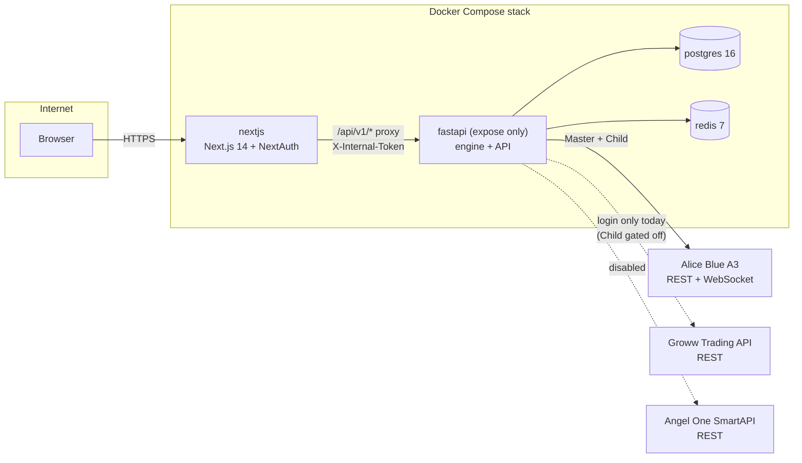
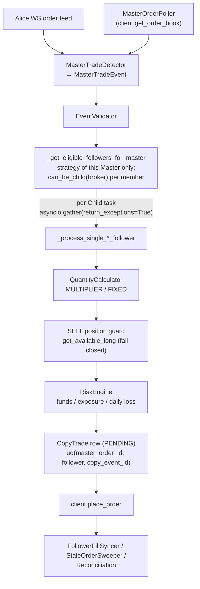

# 01 · Current-state architecture

Snapshot of the repository at `ebf2472` (production runs `a64c29d`; the difference is tests only).
Everything here is read from the code. Line numbers are approximate and can drift.

## 1.1 Runtime components

- `frontend/src/app/api/v1/[...path]/route.ts` is the only path from browser to engine. `require_internal_token`
  (`backend/app/core/security.py`) fails closed. This boundary is unchanged by the proposal.
- `EngineLoop` (`services/runtime/engine_loop.py`) starts one `MasterTradeDetector` + `MasterOrderPoller` per strategy
  Master, plus the Alice Blue WebSocket for the account typed `MASTER`. It imports `AliceBlueWebSocketClient`
  directly (line ~38) and polls via `client.get_order_book()` (line ~624). The poller itself is broker-generic.
- `ENGINE_LIVE_TRADING_ENABLED=false` puts the loop in observe-only mode.

## 1.2 Copy pipeline (one Master → N Children, today)

Key facts:

| Concern | Where | Behaviour |
|---|---|---|
| Routing | `pipeline.py` `_get_eligible_followers_for_master` (~3656) | Only Children of the non-deleted strategy whose Master placed the order; `can_be_child(m.account.broker)` skips others with `CHILD_BROKER_NOT_READY` (~3748). No "copy to all" fallback. |
| Fan-out isolation | `pipeline.py` ~666, ~1144, ~3180 | Per-Child coroutines under `asyncio.gather(..., return_exceptions=True)`; one Child's exception does not abort the others. |
| Idempotency | `events.py` `derive_copy_event_id` | `uuid5(master_order_id, follower_account_id, fill_sequence)`, enforced by DB unique constraint `uq_copy_trades_triple`. |
| LIMIT price | `replicate_limit_order` / `_process_single_limit_follower` | Child LIMIT = exact Master limit price. |
| MARKET conversion | `_process_single_market_follower` | Optional marketable LIMIT; `MARKET_ORDER_BUFFER_PERCENT` (`config.py:104`, **default `0`**) applies only here. |
| SELL guard | `pipeline.py` `_enforce_sell_position_safety` (~3037), `risk_inputs.get_available_long` (~191) | Broker position book only; unknown = reject; bypassable only by `SELL_POSITION_SAFETY_BYPASS` (production: `true`). |
| Funds | `RiskEngine`, `FUNDS_FETCH_FAILED` | Unavailable funds = reject, order not placed. |
| Unknown send outcome | `_record_unresolved_send` (~1068), `StaleOrderSweeper` | Left unresolved for review; never auto-resent by the pipeline. **Exception:** Alice Blue `RetryPolicy` re-sends on post-send transport errors (open defect, `tests/test_alice_blue_send_findings.py`). |

## 1.3 Broker abstraction today

- `brokers/registry.py` — single source of truth: `BrokerSpec{support, capabilities{login, as_master, as_child}, order_label, session_prefix, uses_vault}`. Alice: login+master+child. Groww/Angel: `PARTIAL`, flags + contract gates. Every other catalog broker (`zerodha`, `5paisa`, `dhan`, `fyers`, …) is `NOT_SUPPORTED` ("No adapter is implemented for this broker yet").
- `alice_blue/manager.py` `_build_client` — the one registry-driven client constructor; never falls back to Alice for another broker.
- Adapters are **duck-typed**, not interface-bound. Shared surface across Alice, Groww, Angel: `place_order`, `cancel_order`, `modify_order`, `get_order_book`, `get_positions_or_none`, `get_funds`. Groww and Angel also have `resolve_instrument(exchange, symbol)` and `login()`.
- `risk_inputs.get_available_long` already distinguishes "own instrument master" clients (`type(client).resolve_instrument`, ~268) from Alice (master token is authoritative). This is the seed of cross-broker instrument mapping.

## 1.4 Alice-Blue-only dependencies (outside the adapter)

| Dependency | Location | Effect for other brokers |
|---|---|---|
| WebSocket order feed | `alice_blue/websocket.py`, `engine_loop.py` | Master detection for others is polling-only |
| Type hints `AliceBlueClient` throughout pipeline | `pipeline.py` | Cosmetic; behaviour is duck-typed |
| Raw order/position reads | `get_order_book_raw`, `get_positions_raw`, `get_positions_detail` | P&L, square-off, master-switch preflight are Alice-only; others get explicit UNAVAILABLE / 409 (`a64c29d`) |
| OAuth callback | `api/accounts.py` | Alice only; refuses others |
| Instrument resolution from master token | `alice_blue/instruments.py` | Alice child trusts master's `instrument_id`; correct only when Master is also Alice |
| `KNOWN_INSTRUMENTS` static table + contract master CSV | `alice_blue/instruments.py` | Alice-specific tokens |
| Lot size | `pipeline._get_lot_size` defaults to 1 | F&O lots not validated (Groww validates its own) |

## 1.5 Data model (relevant tables)

| Table | Role today |
|---|---|
| `accounts` | `account_type` (MASTER/FOLLOWER), `broker` (string, default `alicebluenew`), session flags |
| `api_credentials` / `broker_credentials` | Alice secret / encrypted vault for Groww & Angel |
| `group_strategies` | `master_account_id`, `trading_enabled` |
| `strategy_members` | Child links: `multiplier`, `trading_enabled`; `uq(strategy_id, account_id)` |
| `strategy_account_roles` | `uq(account_id)`: an account is in at most one strategy, as Master or Child (migration 0008) |
| `copy_settings` | per-Child `quantity_mode`, `fixed_qty`, risk knobs |
| `orders` | Master and Child orders; `broker`, `broker_order_id`, `master_broker_order_id`, `status`, fills |
| `copy_trades` | per-Child execution record; `status ∈ {PENDING, SUBMITTED, SUCCESS, REJECTED, TIMEOUT, FAILED, SKIPPED, RECONCILIATION_REQUIRED}` |
| `audit_logs` / `system_events` | reason codes (`RISK_REJECTED`, `INSUFFICIENT_LONG_POSITION`, `CHILD_BROKER_NOT_READY`, …) |

Migrations: `0001`–`0012`, latest `0012_broker_credentials`.

## 1.6 Test and deployment constraints

- 2582 backend tests (in-memory SQLite, mocked brokers, no network). Broker-specific suites: `test_groww_*`, `test_angel_one_*`, `test_capability_gates.py`, `test_master_poller_other_brokers.py`, `test_raw_position_row_sell_guard.py`.
- One static VPS IP; Alice whitelists by IP; Groww and Angel require per-account static IP for order calls.
- Every engine restart re-baselines the Master pollers; pre-restart orders are never replicated.
