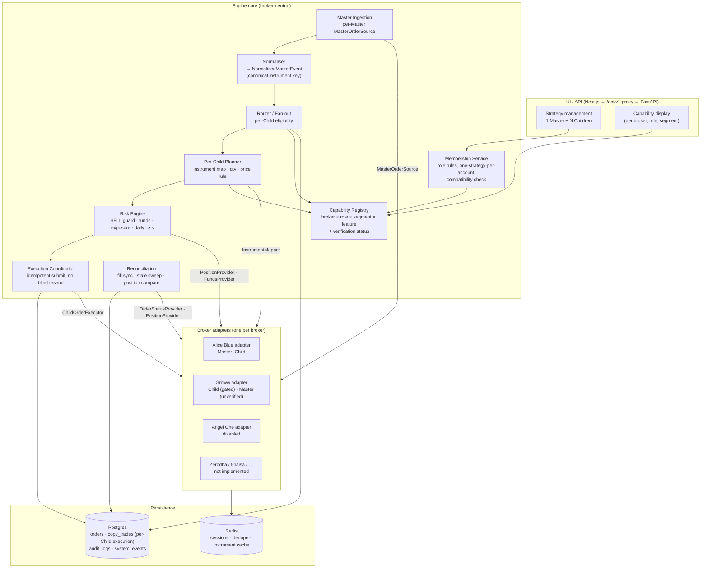
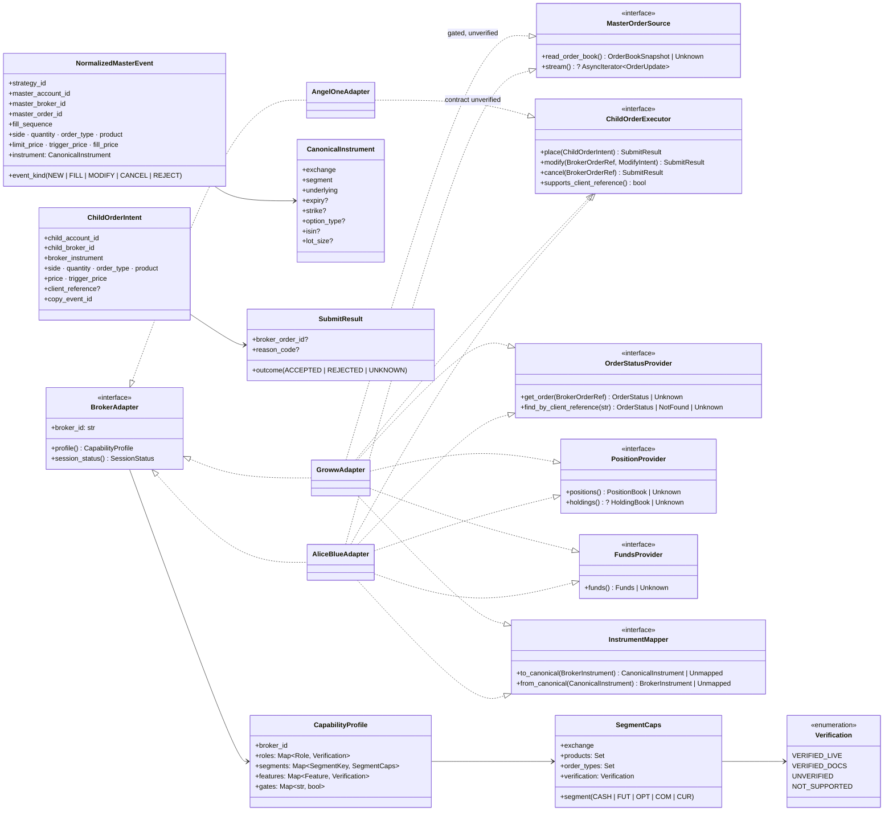

# 02 · Target architecture: one Master, N heterogeneous Children

Design principle: **additive boundaries around the existing pipeline.** The pipeline keeps its current
routing, pricing, SELL guard, funds, idempotency and reconciliation logic. What changes is *how it asks a broker
for something*: through narrow, capability-checked interfaces resolved per account, instead of duck-typed calls on
whatever client object is in the dict.

## 2.1 Target component diagram

### Fan-out rule
For each `NormalizedMasterEvent`, the Router builds **one independent work item per Child**. Each item runs in
its own task with its own capability check, instrument mapping, quantity, risk evaluation, `copy_trades` row and
broker call. A failure or outage in one item is recorded on that item only (existing `gather(return_exceptions=True)`
pattern, kept). No item's outcome changes another item's status, and no item is retried because a sibling failed.

## 2.2 UML class diagram (interfaces are design candidates)

### Interface evaluation

| Candidate | Keep? | Why |
|---|---|---|
| `BrokerAdapter` | Yes, thin | Identity, capability profile, session status. Not a god-interface: each role is a separate interface, so a Child-only broker never has to fake Master methods. |
| `MasterOrderSource` | Yes | Wraps today's `get_order_book()` for `MasterOrderPoller` and the optional Alice WS stream. Must return **Unknown** (not empty) on a failed read. |
| `ChildOrderExecutor` | Yes | `place/modify/cancel` with a three-valued `SubmitResult`. `UNKNOWN` is first-class so no adapter can hide an ambiguous send as a retryable error. |
| `OrderStatusProvider` | Yes | Separate from the executor because fill sync and reconciliation need it without placing orders. `find_by_client_reference` only for brokers that send a reference (Groww today). |
| `PositionProvider` | Yes | Maps to `get_positions_or_none()`; `holdings()` optional and **unverified for every broker** in the repo. |
| `FundsProvider` | Yes | Maps to `get_funds()`; Unknown = fail closed. |
| `InstrumentMapper` | Yes — the key new piece | Cross-broker copies need canonical instrument identity; a Master broker's token means nothing to another broker (already acknowledged in `risk_inputs.py` ~263). |

Implementation note: the first step is to declare these as `typing.Protocol`s that the **existing** client classes
already satisfy (structural typing), so Alice Blue behaviour is untouched. Wrapper adapters are added only where a
method's semantics differ (e.g. Unknown vs empty).

## 2.3 Per-Child planner rules (in order, each fails closed)

1. Child membership enabled, account active, not emergency-stopped (existing).
2. Child broker's `role=CHILD` verification ≥ required level and its gate flag on (existing `can_be_child`, extended).
3. Strategy compatibility: Master broker → Child broker pair allowed (see 05).
4. Instrument: `InstrumentMapper.from_canonical` returns a mapped instrument for this Child broker; segment supported for this broker; else `SKIPPED: INSTRUMENT_UNMAPPED` / `SEGMENT_NOT_SUPPORTED`.
5. Product and order type supported for that segment on that broker; else `SKIPPED: PRODUCT_NOT_SUPPORTED` / `ORDER_TYPE_NOT_SUPPORTED`. No silent substitution (e.g. never turn SL-M into MARKET).

   **Decision D1:** a segment, product or order type the Child broker cannot handle skips **only that Child's
   execution for that order**, with the reason recorded on its `copy_trades` row and in `audit_logs`. It never
   blocks the order for other Children. At membership time the API and UI show a non-blocking warning listing the
   segments, products and order types this Child will not receive (`CHILD_SEGMENT_COVERAGE_WARNING`); the Child
   can still be added if its broker's Child role is enabled.
6. Quantity: existing `QuantityCalculator`; lot multiple must be exact where the broker exposes lot size; never rounded.
7. Price: LIMIT → exact Master limit price; MARKET → existing marketable-LIMIT rule with `MARKET_ORDER_BUFFER_PERCENT` (default 0). Tick-size validation is a known gap for every broker; it is not invented here.
8. Risk: SELL guard (Child's own position book via its `PositionProvider`), funds (`FundsProvider`), exposure, daily loss — all existing, all fail closed.
9. Persist `copy_trades` row (unique triple) **before** the broker call; then submit.
