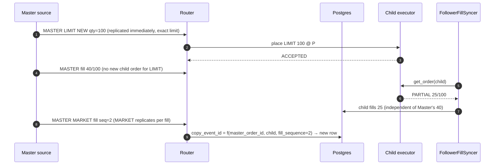
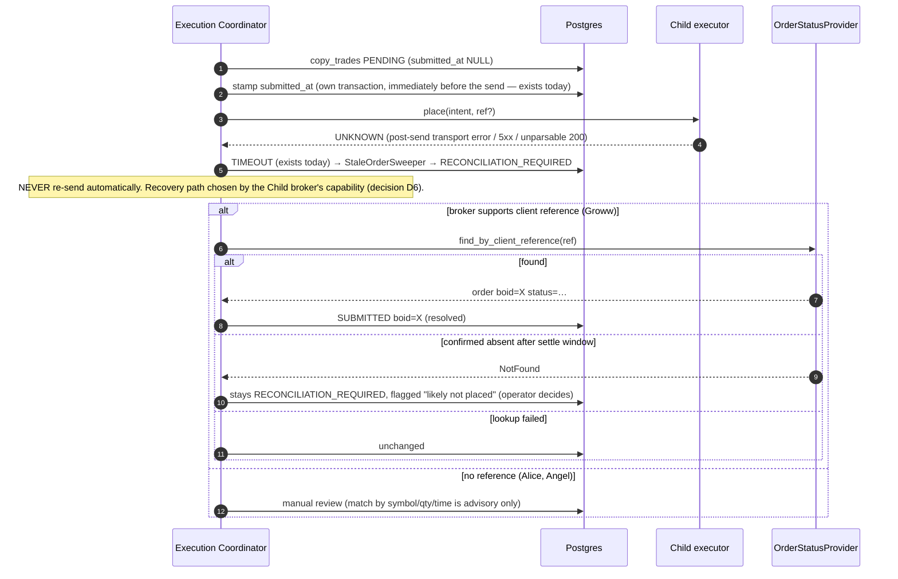
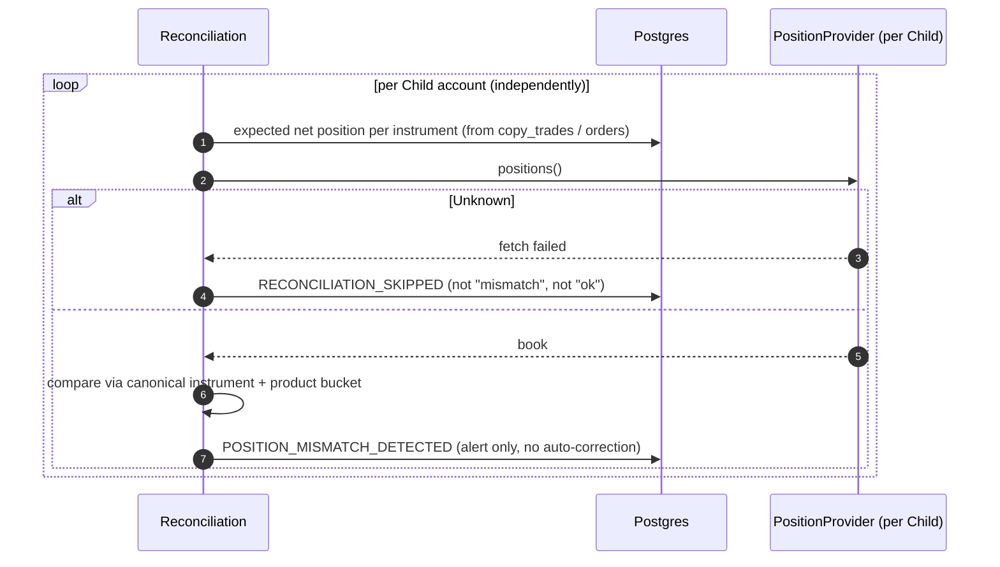

# 03 · Sequence diagrams

All diagrams show one Master and several Children on different brokers. Child B's broker failing never changes
Child A's or Child C's outcome.

## 3.1 Master order ingestion

```mermaid
sequenceDiagram
  autonumber
  participant MB as Master broker
  participant SRC as MasterOrderSource (per Master)
  participant DET as Detector
  participant NORM as Normaliser + InstrumentMapper(master)
  participant RT as Router

  loop every poll interval (or WS push, Alice only)
    SRC->>MB: read order book
    alt read failed / unparseable / possibly truncated page
      MB-->>SRC: error
      SRC-->>DET: Unknown (poll skipped, nothing inferred)
    else ok
      MB-->>SRC: rows
      SRC->>DET: snapshot
      DET->>DET: diff vs baseline (seeded at start; pre-start orders ineligible)
      DET->>NORM: new / fill / modify / cancel deltas
      alt instrument cannot be canonicalised
        NORM-->>RT: event with instrument=Unmapped (audited; Children will skip)
      else
        NORM-->>RT: NormalizedMasterEvent(master_broker, master_order_id, fill_sequence, …)
      end
    end
  end
```

## 3.2 Child execution fan-out (heterogeneous Children)

```mermaid
sequenceDiagram
  autonumber
  participant RT as Router
  participant REG as Capability Registry
  participant DB as Postgres
  participant CA as Child A (Alice)
  participant CB as Child B (Groww)
  participant CC as Child C (Zerodha)

  RT->>REG: eligibility(strategy, master_broker, each Child)
  REG-->>RT: A eligible · B eligible (CASH only) · C NOT_SUPPORTED
  RT->>DB: audit C: SKIPPED CHILD_BROKER_NOT_READY
  par Child A
    RT->>RT: map instrument → Alice token; qty; price rule; SELL guard; funds
    RT->>DB: INSERT copy_trades (uq triple) PENDING
    RT->>CA: place(intent)
    CA-->>RT: ACCEPTED boid=A1
    RT->>DB: SUBMITTED boid=A1
  and Child B
    RT->>RT: map instrument → Groww symbol
    alt Master order is NFO option
      RT->>DB: SKIPPED SEGMENT_NOT_SUPPORTED (no order)
    else NSE equity
      RT->>DB: INSERT copy_trades PENDING (client_reference=R_B)
      RT->>CB: place(intent, ref=R_B)
      CB-->>RT: REJECTED (e.g. static IP)
      RT->>DB: REJECTED reason=broker message
    end
  end
  Note over RT,DB: A stays SUBMITTED. B's rejection is not retried and never touches A.
```

## 3.3 Partial fills



Per-Child fills are tracked independently; the Child's fill ratio never drives another Child.

## 3.4 Master cancellation

```mermaid
sequenceDiagram
  autonumber
  participant SRC as Master source
  participant RT as Router (existing_children_lookup)
  participant DB as Postgres
  participant CA as Child A
  participant CB as Child B

  SRC->>RT: MASTER CANCEL order M
  RT->>DB: find children of M (never creates new children)
  par
    RT->>CA: cancel(A1) — pending qty only
    CA-->>RT: CANCELLED
    RT->>DB: A: CANCELLED (filled part kept)
  and
    RT->>CB: cancel(B1)
    CB-->>RT: Unknown (timeout)
    RT->>DB: B: cancel outcome UNKNOWN → re-read status later; no blind re-cancel loop
  end
  Note over RT: Already-filled child quantity is never squared off automatically.
```

## 3.5 Duplicate events

```mermaid
sequenceDiagram
  autonumber
  participant SRC as Source (poll + WS, or restart replay)
  participant RT as Router
  participant DB as Postgres

  SRC->>RT: event(M, fill_seq=1)
  RT->>DB: INSERT copy_trades(M, child, copy_event_id) ✔
  SRC->>RT: same event again
  RT->>DB: INSERT … ✖ unique violation
  RT-->>RT: treat as already handled; no broker call
```

The unique constraint is the authority, not in-memory dedupe. Multi-Master-broker change: see 06 §6.3 on
namespacing `master_order_id` by Master broker for **new** combinations only.

## 3.6 Timeout / unknown submission outcome



## 3.7 Reconciliation



Reconciliation never places, cancels or squares off orders. Broker position book is truth; the DB is not.

## 3.8 Supervised resume after a restart (decision D2)

Today an engine restart re-baselines the Master pollers, and any Child that had not been attempted for an
in-flight event is simply never copied. The design replaces that silent loss with a **supervised** resume. It never
resends anything automatically.

```mermaid
sequenceDiagram
  autonumber
  participant BOOT as Engine startup
  participant DB as Postgres (fan-out ledger + copy_trades)
  participant OSP as OrderStatusProvider (per Child)
  participant OP as Operator (UI)
  participant EX as Execution Coordinator

  BOOT->>DB: fan-out ledger entries without completed_at (events interrupted by the restart)
  loop per interrupted event, per eligible Child (independently)
    alt Child has a copy_trades row with submitted_at set and no broker ack
      BOOT->>OSP: reconcile (reference lookup if the broker supports it, else manual)
      OSP-->>BOOT: found / not found / unknown
      BOOT->>DB: resolved, or left RECONCILIATION_REQUIRED
    else Child has a row with submitted_at NULL, or no row at all
      BOOT->>OSP: reconcile anyway (the submitted_at stamp can fail; absence is not proof)
      BOOT->>DB: mark RESUME_CANDIDATE only if reconciliation confirms nothing exists at the broker
    end
  end
  BOOT->>OP: list resume candidates (Master order, Child, original price, current Master state)
  OP->>EX: approve selected candidates (or close them as NOT_COPIED)
  EX->>EX: re-run the full per-Child planner (capability, mapping, qty, exact price rule, SELL guard, funds)
  EX->>DB: same copy_event_id / same row, retry_count+1, same client reference where supported
  EX->>OSP: place (only after approval)
```

Rules: resume is per Child, needs explicit operator approval, re-runs every check with fresh data, keeps the
original pricing rule (exact Master LIMIT price; MARKET-conversion buffer only for converted MARKET orders), and is
offered only for the same trading day while the Master order or fill is still relevant. Anything still ambiguous
after reconciliation stays in manual review and is never offered for resume.
