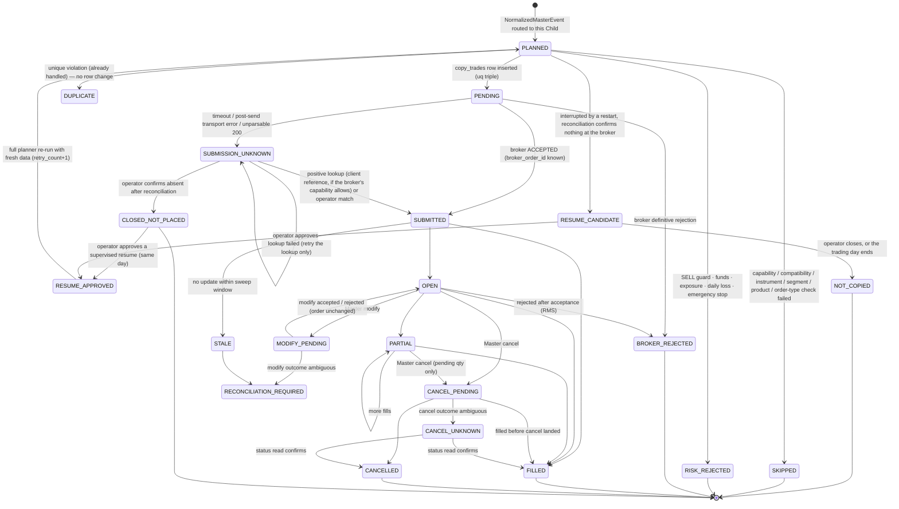

# 04 · Per-Child execution state machine

One state machine instance per `(master_order_id, child_account_id, copy_event_id)` — i.e. per `copy_trades` row.
Children never share a state.

## 4.1 Diagram

## 4.2 Mapping to existing columns (no enum migration in phase 1)

| Design state | `copy_trades.status` today | Child `orders.status` |
|---|---|---|
| SKIPPED | no row (audit `CHILD_BROKER_NOT_READY`, …) or `SKIPPED` | — |
| RISK_REJECTED | `RECONCILIATION_REQUIRED` with `failure_reason` (as in the 8 production records) or `REJECTED` | — |
| PENDING | `PENDING` | `PENDING` |
| SUBMITTED / OPEN / PARTIAL | `SUBMITTED` | `OPEN` / `PARTIAL` |
| FILLED | `SUCCESS` | `COMPLETE` |
| BROKER_REJECTED | `REJECTED` / `FAILED` | `REJECTED` |
| SUBMISSION_UNKNOWN | `TIMEOUT` (`_record_unresolved_send`), then `RECONCILIATION_REQUIRED` via the sweeper | `PENDING` |
| STALE | `RECONCILIATION_REQUIRED` (`StaleOrderSweeper`) | `PENDING` / `OPEN` |
| RESUME_CANDIDATE / RESUME_APPROVED / NOT_COPIED | new (`outcome_class` + fan-out ledger, 06 §6.2) | — |
| CANCELLED | `FAILED` ("Master order cancelled; child order cancelled at broker") | `CANCELLED` |

Observation: today a pre-submission risk block and a genuinely ambiguous submission can both land in
`RECONCILIATION_REQUIRED`. The proposal (06 §6.2) adds a nullable `outcome_class` column to tell them apart
without changing existing values.

## 4.3 Recovery rules

1. **No automatic resend from any state.** A broker order is placed for a `copy_event_id` either on the first
   attempt or, after reconciliation, on an operator-approved supervised resume (D2). Nothing else.
2. **Unknown-submission recovery depends on the Child broker's capability (D6):**

   | Child broker capability | Positive lookup | Negative lookup / lookup failed |
   |---|---|---|
   | Client order reference, VERIFIED_LIVE | Resolve automatically to SUBMITTED | Operator review |
   | Client order reference, VERIFIED_DOCS only (Groww today) | Shown to the operator as "found"; operator confirms | Operator review |
   | No client reference (Alice Blue, Angel One) | — | Operator review; symbol/qty/time matching is advisory only |

   Manual review is always the fallback. No policy ever resends automatically.

   Note: the existing Groww timeout reconciliation (`StaleOrderSweeper`, reference map) already resolves
   automatically. Groww Child trading is gated off, so this does not run in production today. Before R5, either
   gate that automatic step behind `live_verified`, or accept it explicitly as the Groww policy.
3. Ambiguous cancel/modify: re-read the order status; never loop cancels; never square off.
4. A Child in any terminal or unknown state never blocks its siblings and never causes their retry.
5. Engine restart: in-flight rows are flagged by crash recovery (`reconciliation.py`), not resent. Children that
   were never attempted become resume candidates only after reconciliation (03 §3.8).
6. A resumed attempt keeps the original `copy_event_id` and row (`retry_count + 1`), so the unique triple still
   allows at most one row per Child per event.
