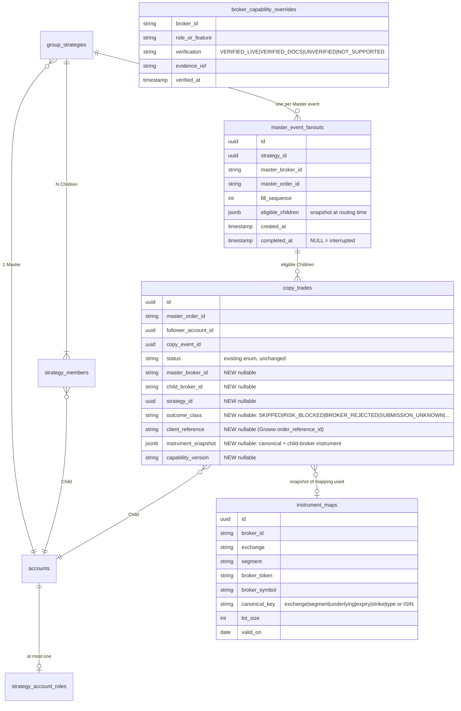

# 06 · Data model and migration proposal

**Proposal only. No migration is written or run.** All changes are additive (new nullable columns or new
tables); no existing column changes meaning, and Alice → Alice rows remain valid unchanged.

## 6.1 What already fits

| Requirement | Already satisfied by |
|---|---|
| One explicit Master per strategy | `group_strategies.master_account_id` |
| N Children with multiplier and enabled flag | `strategy_members(multiplier, trading_enabled)` |
| Per-Child quantity mode and risk knobs | `copy_settings` |
| Account in at most one strategy, either role | `strategy_account_roles uq(account_id)` (migration 0008) — **kept** |
| Explicit broker identity per account | `accounts.broker` (string, registry-resolved) |
| Per-Child execution record | `copy_trades` + Child `orders` row |
| Idempotency | `uq_copy_trades_triple(master_order_id, follower_account_id, copy_event_id)` |

## 6.2 Proposed additive changes

| Change | Why | Risk to Alice → Alice |
|---|---|---|
| `copy_trades.master_broker_id`, `child_broker_id`, `strategy_id` (nullable) | Per-Child records self-describe their pair; reporting by broker; today `orders.group_strategy_id` is NULL on Master orders | None: nullable, backfill optional (`alicebluenew`) |
| `copy_trades.outcome_class` (nullable) | Separates "blocked before send" from "sent, outcome unknown" (both `RECONCILIATION_REQUIRED` today) | None: existing `status` untouched |
| `copy_trades.client_reference` (nullable, unique where not null) | Reference-based reconciliation; already generated by Groww adapter | None |
| `copy_trades.instrument_snapshot` (jsonb, nullable) | Audit of which mapping produced the child instrument | None |
| `instrument_maps` table (optional) | Canonical instrument identity across brokers; today mappings live in Redis/in-memory per broker | None; Alice can keep its own resolver until cross-broker needed |
| `broker_capability_overrides` (optional, **read-only for the engine**) | Record verification evidence; code constants stay the gate | Must never be able to *raise* a capability above what code allows |
| `master_event_fanouts` table (new) | Supervised restart resume (D2): one row per Master event, written **before** any Child is attempted. Columns: `strategy_id`, `master_broker_id`, `master_order_id`, `fill_sequence`, `eligible_children` (jsonb snapshot of Child ids at routing time), `created_at`, `completed_at` (set when every eligible Child has a recorded outcome) | None: write-only addition; Alice → Alice routing unchanged. An interrupted event is one with `completed_at` NULL |

`copy_trades.submitted_at` already exists and is stamped in its own transaction immediately before each send
(`pipeline._stamp_submitted`). The resume design reuses it; no new "send started" column is needed. Because that
stamp can fail (logged, not fatal), `submitted_at IS NULL` is treated as "probably not sent", never as proof:
reconciliation always runs first.

`outcome_class` values used by the decisions: `SKIPPED`, `RISK_BLOCKED`, `BROKER_REJECTED`, `SUBMISSION_UNKNOWN`,
`RESUME_CANDIDATE`, `RESUME_APPROVED`, `NOT_COPIED`, `CLOSED_NOT_PLACED`.

### Combined P&L status (decision D3)

No schema change. The API response gains an explicit completeness field so an incomplete total can never be shown
as complete:

| Field | Values | Rule |
|---|---|---|
| `combined_status` | `COMPLETE` · `PARTIAL` · `UNAVAILABLE` | `COMPLETE` only when every account in scope has a verified figure |
| `combined_total` | number or `null` | Present for `COMPLETE`; for `PARTIAL` only as `partial_total` beside the list of excluded accounts and reasons; `null` for `UNAVAILABLE` |
| `excluded_accounts` | list of `{account_id, broker, reason}` | e.g. `PNL_NOT_SUPPORTED_FOR_BROKER` |

Today the code already withholds `combined_total` (null) when any account is unavailable and reports
`accounts_unavailable`; D3 keeps that and adds the explicit status and the labelled partial figure.

**Capability gates stay in code + env flags.** A DB row may only *lower* (disable) a capability, never enable one,
so a data change cannot turn on trading.

## 6.3 Idempotency keys with multiple Master brokers

- Today: `copy_event_id = uuid5(master_order_id, follower_account_id, fill_sequence)`.
- Risk: `master_order_id` is unique only within one broker. Two brokers could emit the same string.
- Proposal: for **new** pairs only, derive with a broker namespace:
  `uuid5(master_broker_id + ":" + master_order_id, follower_account_id, fill_sequence)`.
  Alice → Alice keeps the existing derivation (keys must not change for in-flight/historical rows).
- Unique constraint stays the triple; it remains correct because the namespaced key is part of it.
- Child `client_reference` (where supported) is derived from `copy_event_id` so it is stable across retries of the
  *lookup* and never produces a second order.

## 6.4 Account roles

- Keep `accounts.account_type` as is (legacy MASTER/FOLLOWER) and keep `strategy_account_roles` as the real role
  source. No change to the one-strategy-per-account rule.
- A broker that is Child-only (Groww today) can never be selected as Master: enforced at membership and
  switch-master (exists).

## 6.5 Migration plan (when approved)

1. `0013_copy_trades_broker_context`: add nullable columns + partial unique index on `client_reference`. No backfill required.
2. `0014_master_event_fanouts` (needed for supervised resume).
3. Optional `0015_instrument_maps` and `0016_broker_capability_overrides`.
4. Each migration reversible (`downgrade` drops only the new objects). Tested on a restored `pg_dump` copy first.
5. Main.py's startup `ALTER TABLE … IF NOT EXISTS` safety net is **not** extended; Alembic only.
